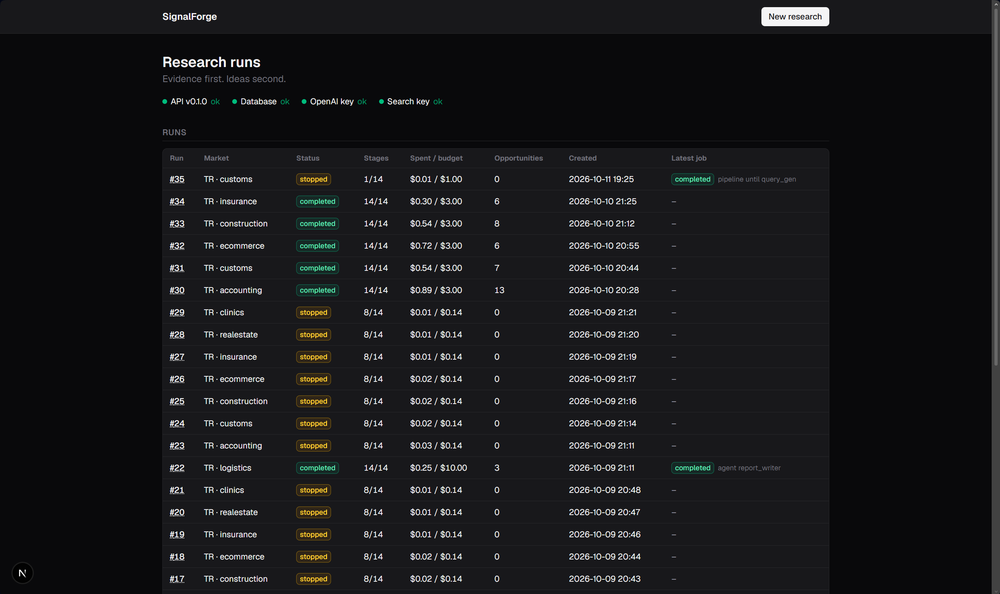
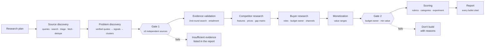
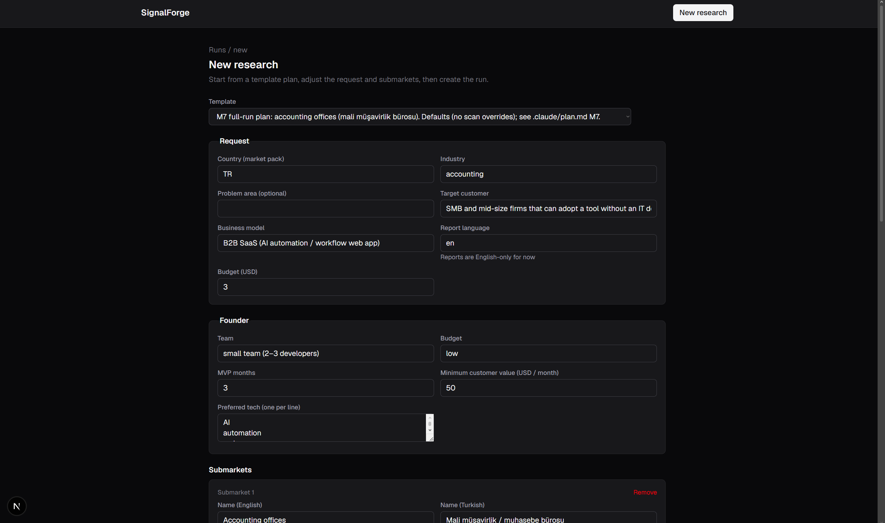
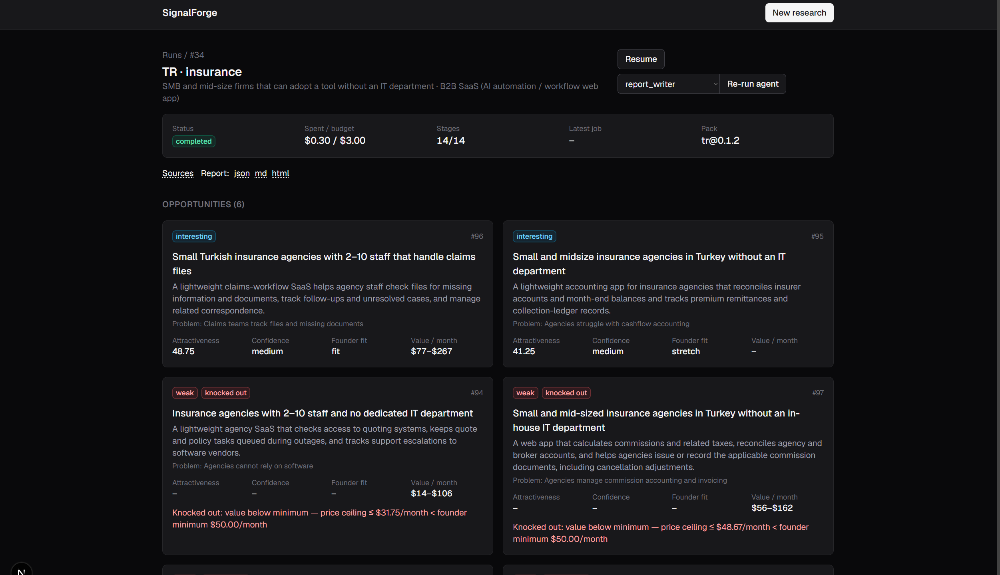
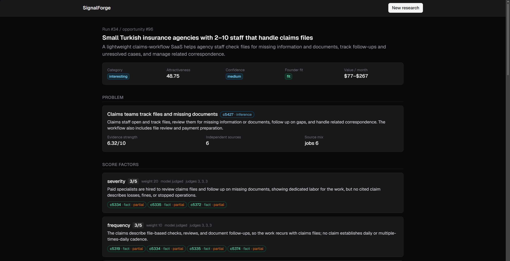

<h1 align="center">SignalForge</h1>

<p align="center">
  <b>An open-source research engine that finds evidence-backed business problems and tells you which ones are worth building.</b><br/>
  <i>Evidence first. Ideas second. "Don't build this" is a successful result.</i>
</p>

<p align="center">
  
  
  
  
  
  
</p>

<p align="center">
  
</p>

---

## What it does

You describe a market: a country, an industry, who you'd sell to and what kind of founder you are.
SignalForge then searches the web in that market's language and reads job ads, complaints, forums
and regulations. It extracts **verbatim quotes** that show real pain and groups them into problems.
It then researches competitors, buyers and money, and hands you a scored, fully cited report.

Every claim in the report traces back to a stored quote on a page it actually fetched. When the
evidence isn't there, SignalForge says **"insufficient evidence"** and doesn't fill the gap.

**Who it's for:** solo founders, indie hackers, small teams and agencies looking for a B2B problem
worth solving. **First market:** Turkey 🇹🇷. Other countries plug in as *market packs*.

## Why it's different

| Most "AI idea generators" | SignalForge |
|---|---|
| The LLM invents the problems | The LLM only reasons over evidence it collected; search comes first |
| Quotes and stats can be hallucinated | Every quote must match the fetched page **verbatim**, or it's dropped |
| "10 sources agree" (all copies of one post) | Counts **independent** sources: duplicates, reposts and the same author collapse into one |
| Opinions and facts blur together | Every claim is typed: `fact`, `inference`, `hypothesis` or `assumption` |
| One magic score | Three separate outputs: **attractiveness**, **confidence**, **founder fit** |
| Point estimates of market value | Value **ranges** computed by code from dated, sourced assumptions |
| Surprise API bills | A hard **per-run budget cap**, a cost ledger, and a cache that makes re-runs free |

## How it works

A research run is a funnel of stages with two hard gates. The expensive stages only run on the
problems that survive.



Each stage is idempotent and recorded, so a run can be **resumed**, and any agent can be
**re-run** on its own. Search results, pages and LLM responses are cached, so re-running a later
stage doesn't pay again for the earlier ones.

---

## A quick tour

<table>
  <tr>
    <td width="50%"></td>
    <td width="50%"></td>
  </tr>
  <tr>
    <td><b>1. Plan the research.</b> Start from a template, then adjust the market, target customer, your founder constraints, budget and submarkets.</td>
    <td><b>2. Watch it run and read the results.</b> Progress is shown per agent. Opportunities arrive as cards with category, attractiveness, confidence, founder fit and value per month. Knocked-out ideas say why.</td>
  </tr>
  <tr>
    <td colspan="2"></td>
  </tr>
  <tr>
    <td colspan="2"><b>3. Check every claim.</b> Each score factor shows its judgment and the claims it rests on. Click a claim chip to see the original Turkish quote, its translation, how well it supports the claim, and a link to the source page.</td>
  </tr>
</table>

---

## Quick start

### Prerequisites

| Tool | Version | Used for |
|---|---|---|
| [Python](https://www.python.org/downloads/) | 3.12+ | research engine, API, worker |
| [Node.js](https://nodejs.org/) + [pnpm](https://pnpm.io/installation) | Node 20+ | web UI |
| [Docker](https://docs.docker.com/get-docker/) | any recent | Postgres 16 |
| [OpenAI API key](https://platform.openai.com/api-keys) | — | the LLM stages |
| [Serper API key](https://serper.dev) | — | Google search results ([SerpApi](https://serpapi.com) also supported) |

### 1. Clone and configure

```bash
git clone https://github.com/Ernosto0/SignalForge.git signalforge
cd signalforge
cp .env.example .env
```

Open `.env` and fill in three values:

```ini
OPENAI_API_KEY=sk-...
SERPER_API_KEY=...
AUTHOR_HASH_SALT=<any long random string>
```

Generate the salt with `python -c "import secrets; print(secrets.token_hex(32))"`. It's used to
hash source authors, so evidence can be counted per independent author without storing names.
**Keep it stable** for a database: changing it changes every hash.

### 2. Start Postgres

```bash
docker compose up -d db          # Postgres 16 on localhost:5433
```

### 3. Install the backend

<details open>
<summary><b>macOS / Linux</b></summary>

```bash
cd backend
python3.12 -m venv .venv
source .venv/bin/activate
pip install -e . pytest ruff
alembic upgrade head             # create the database tables
```
</details>

<details>
<summary><b>Windows (PowerShell)</b></summary>

```powershell
cd backend
py -3.12 -m venv .venv
.venv\Scripts\Activate.ps1
pip install -e . pytest ruff
alembic upgrade head             # create the database tables
```
</details>

<details>
<summary><b>Using uv instead</b></summary>

```bash
cd backend
uv sync
uv run alembic upgrade head
# then prefix the commands below with `uv run`
```
</details>

### 4. Install the frontend

```bash
cd frontend
pnpm install
```

### 5. Run it

SignalForge runs as three processes. Open three terminals, and activate the backend venv in the
first two:

```bash
# terminal 1: API on http://127.0.0.1:8000 (interactive docs at /docs)
cd backend && signalforge serve --reload

# terminal 2: worker, which picks up research jobs from the queue
cd backend && signalforge worker

# terminal 3: web UI on http://localhost:3000
cd frontend && pnpm dev
```

Open **http://localhost:3000**. The top of the page shows a setup check (API, database, OpenAI key,
search key), and all four should say **ok**.

> [!TIP]
> No worker running? Runs you create will wait in the queue as `queued`. Start the worker and
> they'll be picked up. Stopping the worker with `Ctrl+C` marks the current job as failed and
> leaves the run resumable.

---

## Your first research run, step by step

1. **Click "New research".**
2. **Pick a template.** The templates come from `backend/examples/`: logistics, accounting,
   customs/export, construction, e-commerce, insurance and more. They're the fastest way to see
   what a good plan looks like.
3. **Fill in the request.**
   - *Country*: selects the market pack (`TR` today).
   - *Industry*, *target customer*, *business model*: who you want to sell to.
   - *Budget (USD)*: a hard cap. The run pauses cleanly if it would go over, and you can resume it later.
4. **Describe yourself as a founder.** Team size, budget, MVP months and the **minimum customer
   value per month** you need. These drive *founder fit* and the Gate 2 knock-outs, not the
   attractiveness score.
5. **Edit the submarkets.** This is the biggest lever you have on quality. For each submarket, give
   its name in English and in the local language, the **terms practitioners use** (documents,
   systems, workflows) and the **roles** who feel the pain. Specific terms give you specific evidence.
6. **Optional:** research questions, buyer hypotheses, and topics to **avoid** (e.g. "SEO blog
   posts", "consumer complaints").
7. **Create the run.** You land on the run page, where progress updates live per agent: stages,
   timings, cost and any errors.
8. **Read the opportunity cards** once the run completes. Open one to see:
   - the **problem** and its evidence strength (how many independent sources, and of what kind),
   - each **score factor** with its justification and cited claims,
   - the **economic model** (value range from sourced assumptions),
   - **buyer roles** and channels, the **competitor gap matrix**, and a **validation experiment**
     that targets your riskiest assumption.
9. **Browse the evidence.** "Sources" opens the source explorer: every fetched document with its
   verified quotes and signals, filterable by source category, quality tier, signal type, cluster
   or a text search.
10. **Get the report.** Download it as **HTML**, **Markdown** or **JSON** from the run page.
    The JSON is the source of truth, and every bullet in it carries claim IDs.

**Re-running parts of a run:** use **Resume** to continue a stopped or failed run, or **Re-run
agent** to redo one agent (for example `report_writer` after tweaking a prompt). Cached work is
reused, so this is usually close to free.

---

## Reading the results

| Output | What it means |
|---|---|
| **Category** | `strong` · `interesting` · `competitive` (good demand, little gap) · `weak` (no budget owner, value too low or low severity) · `insufficient evidence`. Assigned by rules, never by the LLM. The rule that fired is stored. |
| **Attractiveness** (0–100) | How good the opportunity is *if its claims are true*. A weighted sum of severity, economic impact, frequency, competition gap, willingness to pay, customer accessibility and market breadth. Each is a 1–5 level on an anchored rubric, and any factor without a cited fact is capped. |
| **Confidence** (low / medium / high) | How much to trust that score: evidence strength, the share of judgments that rest on hypotheses, and disagreement between repeated judgments. |
| **Founder fit** (fit / stretch / not fit) | Whether *you* can build and sell it: MVP time, price ceiling vs your minimum, hard barriers such as licences. |
| **Value / month** | A range in USD, computed by code from dated wage and price assumptions. Never a single point estimate. |
| **Claim chips** | 🟢 `fact` (verified quote) · 🔵 `inference` (derived from facts) · 🟠 `hypothesis` (unproven) · 🟣 `assumption` (model input, sourced or not). `partial` means the quote supports the claim only in part. |

> [!NOTE]
> A run where most ideas are knocked out or marked *insufficient evidence* isn't a failure.
> Finding out cheaply what **not** to build is the point.

## Cost and time

Measured on six Turkish markets with `gpt-6-luna` on every tier:

- **$0.56–0.98 per full run** (median $0.84), including ≈300 Serper searches
- **22–51 minutes** per run
- Re-running a later agent reuses the cache: often **$0**

Every LLM call is written to a ledger (`signalforge ledger --by agent`). Stronger models can be
enabled per tier in `.env` (`LLM_MODEL_ANALYSIS`, `LLM_MODEL_SYNTHESIS`) for higher-quality runs,
at 20–100× the price.

---

## Command line

Everything in the UI is also available from the CLI (run it from `backend/` with the venv active).
The CLI also has the labeling and evaluation tools.

```bash
signalforge run --plan examples/m7/customs.plan.yaml   # new run from a reviewed plan, start to finish
signalforge run --run 31 --resume                      # continue a stopped or failed run
signalforge run --run 31 --agent report_writer         # re-run one agent
signalforge agents --run 31                            # agents, their stages and status
signalforge status 31                                  # stage results, metrics and spend

signalforge landscape 31 --out reports                 # problem landscape report (no LLM)
signalforge gaps 31                                    # competitor gap matrices
signalforge label opportunities 31                     # founder checklist + verdict per opportunity
signalforge evaluate 30 31 32 --out reports/eval.md    # funnel, outcomes and cost across runs

signalforge ledger --run 31 --by agent                 # LLM spend per agent
signalforge search "nakliye irsaliye Excel'de takip"   # one cached search, for exploring
signalforge worker --once                              # run a single queued job, then exit
```

`signalforge --help` lists every command.

### Cache modes

Search results, pages and LLM responses are cached in Postgres. Set `CACHE_MODE` in `.env`, or
pass `--cache-mode` before a command:

| Mode | Behaviour |
|---|---|
| `live` (default) | reuse fresh cache entries, otherwise call out |
| `record` | always call out and overwrite the cache |
| `replay` | cache only: no network, no API keys, and a miss is an error. Makes runs deterministic |

---

## Configuration

| Where | What |
|---|---|
| `.env` | API keys, database URL, models per tier (`fast` / `analysis` / `synthesis`), search provider, default budget, cache mode |
| `backend/config/defaults.yaml` | every cap, threshold, TTL and model price, plus gate and scoring settings |
| `backend/src/signalforge/scoring/rubric.yaml` | the anchored 1–5 rubrics the judges use |
| `backend/market_packs/<country>/` | a market: language and search locale, pain phrases, source registry with quality tiers, dated wage and price references, regulatory seeds |
| `backend/examples/` | research plan templates (they appear in the UI's template picker) |

### Adding a market

A new country is a new **market pack**: a folder under `backend/market_packs/` with `pack.yaml`,
`pain_phrases.yaml`, `sources.yaml`, `economics.yaml` and `regulatory.yaml`. No code changes
should be needed. Use `market_packs/tr/` as the reference, and contributions of new packs are very
welcome.

---

## Project layout

```
backend/
  src/signalforge/
    agents/        the research agents (one module each) and the shared tool-use loop
    pipeline/      stages, runner (resume / --from / budget) and the Postgres job queue
    evidence/      quote verification, dedup, independence, strength, entailment, claims
    scoring/       rubrics, categories, economics, experiment selection
    reporting/     report schema, citation validator, renderers
    providers/     LLM, search (Serper / SerpApi), fetcher, cache
    api/           FastAPI routes for the web UI
    prompts/       versioned prompts, one per stage
  market_packs/    per-country data (Turkey today)
  examples/        research plan templates
frontend/          Next.js 16 · TypeScript · Tailwind
docker-compose.yml Postgres 16 on host port 5433
```

Design notes and the full roadmap live in [`.claude/plan.md`](.claude/plan.md). The API contract
between backend and UI is in [`.claude/m8-spec.md`](.claude/m8-spec.md).

## Development

```bash
cd backend  && ruff check . && ruff format --check . && pytest
cd frontend && pnpm lint && pnpm build
```

Backend tests run against a separate `signalforge_test` database on the same Postgres, which is
created and migrated automatically. They're skipped if Postgres is down.

---

## Status and roadmap

SignalForge is **V0**: the full pipeline works end to end on Turkish B2B markets, with a CLI and a
local web UI.

- ✅ **V1 (evidence-backed discovery):** collection, verified signals, problem clusters,
  verification, competitors, buyers, economics, scoring, cited reports, web UI
- 🔜 **V1.5:** better competitor and buyer research, market-breadth search, platform-specific source adapters
- 🔭 **V2:** iterative autonomous research, embeddings
- 🔭 **V3:** continuous market intelligence

**Known limitations**
- One market pack (Turkey), and reports are in English (quotes stay in Turkish, with translations).
- There's no plan-drafting step yet: you start from a template or write the plan yourself.
- The web UI has **no authentication**. It's meant for local, single-user use, so don't expose it
  to the internet.
- A running job can't be cancelled from the UI. Stop the worker instead, and the run stays resumable.

## Responsible use

- Respects `robots.txt`, rate-limits per domain, and never bypasses logins. Login-walled sites are
  used only as search snippets.
- Stores a salted **hash** of source authors, never names. Full page text stays in your local
  cache and is never exported: reports contain short excerpts and links.
- You bring your own API keys, and everything runs on your machine.

## Contributing

Issues and pull requests are welcome, especially:
- **Market packs** for new countries
- **Source registry** improvements (new high-quality sources, tier corrections)
- **Evaluation:** label runs (`signalforge label …`) and share where the pipeline gets it wrong

Please run the checks in [Development](#development) before opening a PR.

## License

[Apache-2.0](https://www.apache.org/licenses/LICENSE-2.0)
